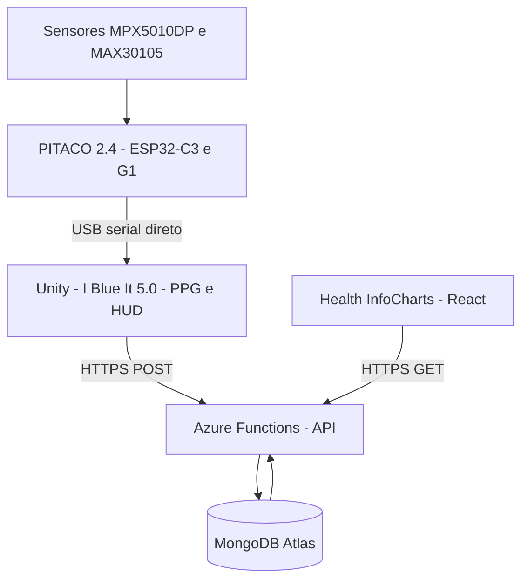

# I Blue It — Extensão IoT do PITACO com monitoramento PPG

**Portfólio de Engenharia de Software · Linha IoT · Católica SC**

> **Estado desta documentação: 23/11/2026.** Este é o portal técnico das melhorias no ecossistema I Blue It. As medições de SpO₂ descritas são **DEMO/experimentais, sem calibração clínica**. O sistema não é apresentado como oxímetro médico nem como mecanismo validado de decisão clínica.

## Navegação

| Comece por | O que encontrará |
| --- | --- |
| [Índice técnico](docs/README.md) | Mapa da documentação e fontes de verdade |
| [Arquitetura IoT ponta a ponta](docs/ARQUITETURA.md) | Camadas, diagramas, componentes e decisões |
| [Integração e fluxo dos dados](docs/INTEGRACOES.md) | Sensores → Unity → Azure → MongoDB → React |
| [Contribuições e escopo](docs/CONTRIBUICOES.md) | O que já existia, o que foi melhorado, status |
| [Execução e demonstração](docs/EXECUCAO.md) | Acesso público à aplicação e roteiro verificável |
| [Evidências de engenharia](docs/EVIDENCIAS.md) | Testes, PRs, Actions e demonstrações |
| [Limitações e riscos](docs/LIMITACOES.md) | Restrições de hardware, SQI e segurança |
| [Conformidade IoT](docs/CONFORMIDADE_IOT.md) | Requisitos do Playbook e lacunas |
| [RFC original preservada](docs/rfc/RFC_v1.5_original.md) | Proposta acadêmica e histórico, não atualizados nesta etapa |

## 1. O problema e o objetivo

O [I Blue It](https://github.com/UDESC-LARVA/iblueit-psychophysiological-flow) é um jogo sério/exergame voltado à reabilitação respiratória, desenvolvido no ecossistema de pesquisa [UDESC-LARVA](https://github.com/UDESC-LARVA). O dispositivo PITACO captura parâmetros respiratórios usados para interagir com o jogo, enquanto os serviços e o Health InfoCharts permitem persistir e visualizar resultados de sessões.

**Esta contribuição** investiga a ampliação do PITACO com aquisição óptica PPG RED/IR, avaliação técnica de qualidade de sinal (SQI), estimativas experimentais de BPM e SpO₂, visualização dentro da Unity e registro/consulta desses dados no ecossistema web. Não substitui o trabalho original do LARVA e não reivindica validação clínica.

A melhoria integra vários repositórios independentes; **este repositório é a porta de entrada**, não uma cópia de todo o código do sistema.

### Arquivo de protótipos e pesquisa SQI

Os estudos de firmware anteriores à integração estão preservados em **[`sqi-test-before-implementatiosn/`](sqi-test-before-implementatiosn/README.md)**: a prova de conceito ESP32/MAX3010x, o estudo Arduino Uno/MAX30102 e o registro de versões históricas do SQI. **Esse código é experimental e não é o firmware canônico atual**; a implementação do PITACO integrada ao sistema está documentada no repositório específico [PITACO_ESP32](https://github.com/PHV00/PITACO_ESP32).

## 2. Sistema em uma visão

**Observação de versões:** o firmware canônico documentado em PITACO_ESP32 usa **ESP32-C3 + MAX30105**. O repositório de estudos inclui **Arduino Uno + MAX30102**; documentos da integração posterior usam o rótulo **PITACO 3.0**. São linhas/configurações a distinguir, não sinônimos automaticamente comprovados. Ver [arquitetura](docs/ARQUITETURA.md#variantes-e-identificadores).

**Conexão do jogo:** a Unity abre **diretamente** a porta USB/serial do firmware PITACO. O Python/bridge é uma ferramenta **separada e opcional**, utilizada para monitoramento, captura e diagnóstico em bancada; não é requisito para executar o jogo. Consulte [arquitetura](docs/ARQUITETURA.md) e [integrações](docs/INTEGRACOES.md).

## 3. Quais melhorias existem hoje?

| Parte | Contribuição documentada | Estado e ressalva |
| --- | --- | --- |
| PITACO/PPG | Coleta RED/IR, detecção de contato, comunicação e Gate 01 | Funcional em testes de bancada/host; ainda requer rastreabilidade do binário gravado e calibração de limiares |
| SQI | Arquitetura hierárquica G1 → G4, testes do G1 e estudos técnicos | **G1 implementado; G2–G4 não concluídos** na linha de estudos |
| Unity | Janela PPG, estimativa de BPM, SpO₂ DEMO, HUD e integração experimental com Mixer/DeepDDA | Integração experimental; SpO₂ não é nova entrada vetorial do ONNX |
| API | Persistência, idempotência e consulta de séries de sessão | Marco 04 implementado; evidência HTTP 201/Atlas em execução registrada |
| Dashboard | Resultados e comparativos com fluxo, BPM, SpO₂ DEMO e RED/IR | Testes/build/deploy aprovados; acesso à instância pode exigir autenticação |
| Publicação | Azure Functions e Azure App Service com GitHub Actions | CI/CD registrado nos repositórios especializados |

**Não confundir:** implementação funcional, teste automatizado, validação em bancada e validação fisiológica são níveis distintos de evidência.

## 4. Onde está cada componente?

| Componente | Repositório | Referência técnica |
| --- | --- | --- |
| Portal técnico, RFC e pesquisa | [RFC-IBlueIt-Pitaco3.0-Multimodal](https://github.com/PHV00/RFC-IBlueIt-Pitaco3.0-Multimodal) | [Arquivo histórico de testes SQI](sqi-test-before-implementatiosn/README.md) |
| Firmware PITACO 2.4 e utilitario Python auxiliar | [PITACO_ESP32](https://github.com/PHV00/PITACO_ESP32) | [Arquitetura do firmware](https://github.com/PHV00/PITACO_ESP32/blob/main/docs/ARCHITECTURE.md) |
| Jogo e processamento Unity | [iblueit-psychophysiological-flow-pitaco2.4-port](https://github.com/PHV00/iblueit-psychophysiological-flow-pitaco2.4-port) | [Consolidação PPG / HUD / DeepDDA](https://github.com/PHV00/iblueit-psychophysiological-flow-pitaco2.4-port/blob/main/docs/marcos/CONSOLIDACAO_PITACO24_UNITY_PPG_DEEPDDA_HUD_2026-11-22.md) |
| API e persistência | [iblueit-server-side](https://github.com/PHV00/iblueit-server-side) | [Marco 04 backend](https://github.com/PHV00/iblueit-server-side/blob/main/docs/MARCO_04_ENCERRAMENTO.md) |
| Aplicação web | [iblueit-health-Infocharts](https://github.com/PHV00/iblueit-health-Infocharts) | [Marco 04 frontend](https://github.com/PHV00/iblueit-health-Infocharts/blob/main/docs/MARCO_04_ENCERRAMENTO.md) |

**Acessibilidade:** PITACO_ESP32 encontrava-se privado no inventário de 23/11/2026; esse link só funciona para usuários autorizados. A disponibilidade pública do código essencial do firmware é uma pendência da [matriz de conformidade](docs/CONFORMIDADE_IOT.md). Os demais links identificam forks/extensões; fontes originais permanecem na [organização UDESC-LARVA](https://github.com/UDESC-LARVA).

## 5. Demonstração da camada web

- [Resultados — Health InfoCharts na Azure](https://iblueit-health-infocharts-cqcfckepc9cma7fq.switzerlandnorth-01.azurewebsites.net/plataforma/resultados)
- [Comparativos — Health InfoCharts na Azure](https://iblueit-health-infocharts-cqcfckepc9cma7fq.switzerlandnorth-01.azurewebsites.net/plataforma/comparativo)

O acesso público ao host não implica acesso anônimo aos dados de pacientes. As evidências de deploy e dos testes de integração estão em [EVIDENCIAS.md](docs/EVIDENCIAS.md); o procedimento de verificação está em [EXECUCAO.md](docs/EXECUCAO.md).

## 6. Limites da entrega e próximos passos

- **SpO₂ DEMO** não é calibrada: não usar em diagnóstico, alarme, ajuste clínico de sessão ou promessa de segurança fisiológica.
- **SQI G1** verifica integridade básica; não certifica periodicidade, morfologia, coerência RED/IR ou exatidão de BPM/SpO₂.
- A integração Unity → API possui evidência funcional registrada, mas a consolidação do fluxo PITACO 3.0 em sua branch principal deve ser conferida separadamente ([PR Unity #14](https://github.com/PHV00/iblueit-psychophysiological-flow-pitaco2.4-port/pull/14)).
- Identificação do hardware real, versão gravada, sincronização das evidências e ensaio físico ponta a ponta ainda exigem maior rastreabilidade.
- A análise estática e de segurança e a comprovação consolidada de observabilidade serão adicionadas em etapas próprias; documentá-las **não significa** que já estejam aprovadas.

Leia as [limitações](docs/LIMITACOES.md) e a [matriz IoT](docs/CONFORMIDADE_IOT.md) antes de interpretar os resultados.

## 7. Desenvolvimento, autoria e fundamentação

O I Blue It e seus componentes preexistentes são fruto das pesquisas e implementações do [UDESC-LARVA](https://github.com/UDESC-LARVA). Este portfólio documenta **uma extensão técnica e experimental** sobre aquela base. A delimitação está em [CONTRIBUICOES.md](docs/CONTRIBUICOES.md); a fundamentação científica e os requisitos inicialmente propostos podem ser consultados na [RFC original preservada](docs/rfc/RFC_v1.5_original.md) e nas [referências SQI](sqi-test-before-implementatiosn/spo2-wrist-sensor/docs/REFERENCES.md).

**Governança documental:** arquitetura integrada e decisões entre repositórios são descritas aqui; configurações, algoritmos, testes e pipelines de cada componente têm sua fonte de verdade no respectivo repositório. A documentação tem data de corte e deve ser atualizada quando novas mudanças forem integradas.

---
[Índice de documentação](docs/README.md) · [Playbook IoT](https://github.com/CatolicaSC-Portfolio/The-Portfolio-Playbook/blob/main/directions/portfolio-directions-iot.md) · [RFC preservada](docs/rfc/RFC_v1.5_original.md)
