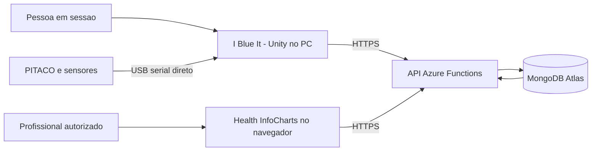
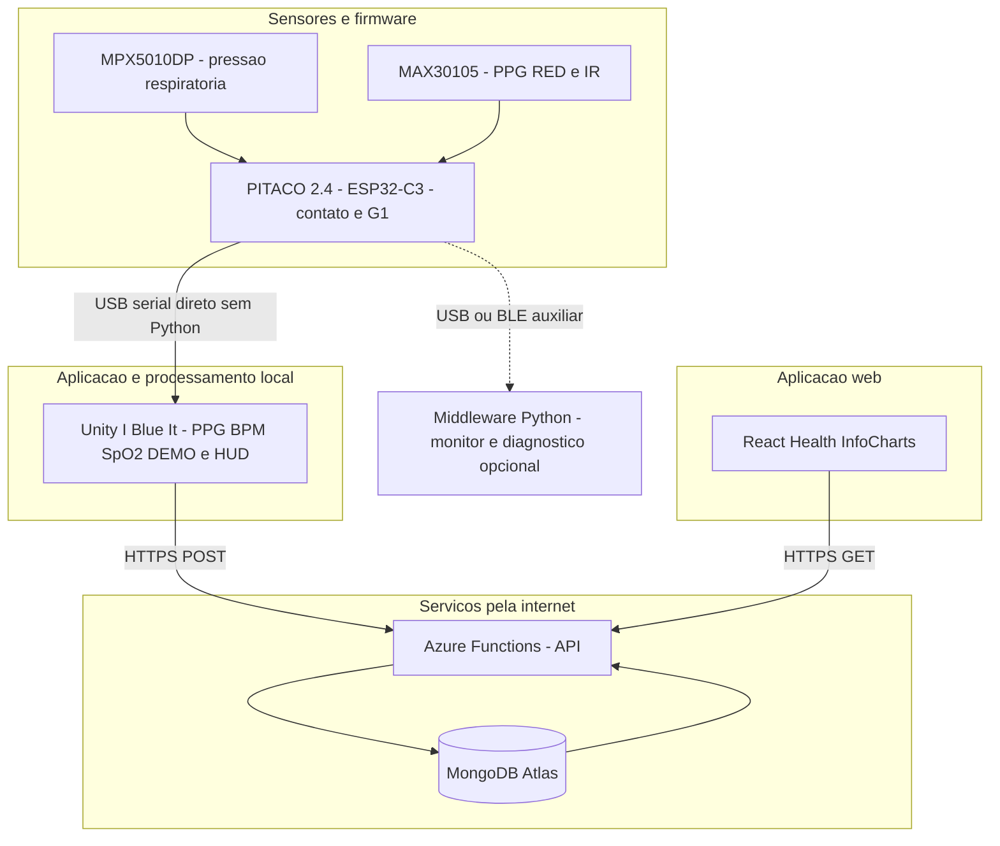
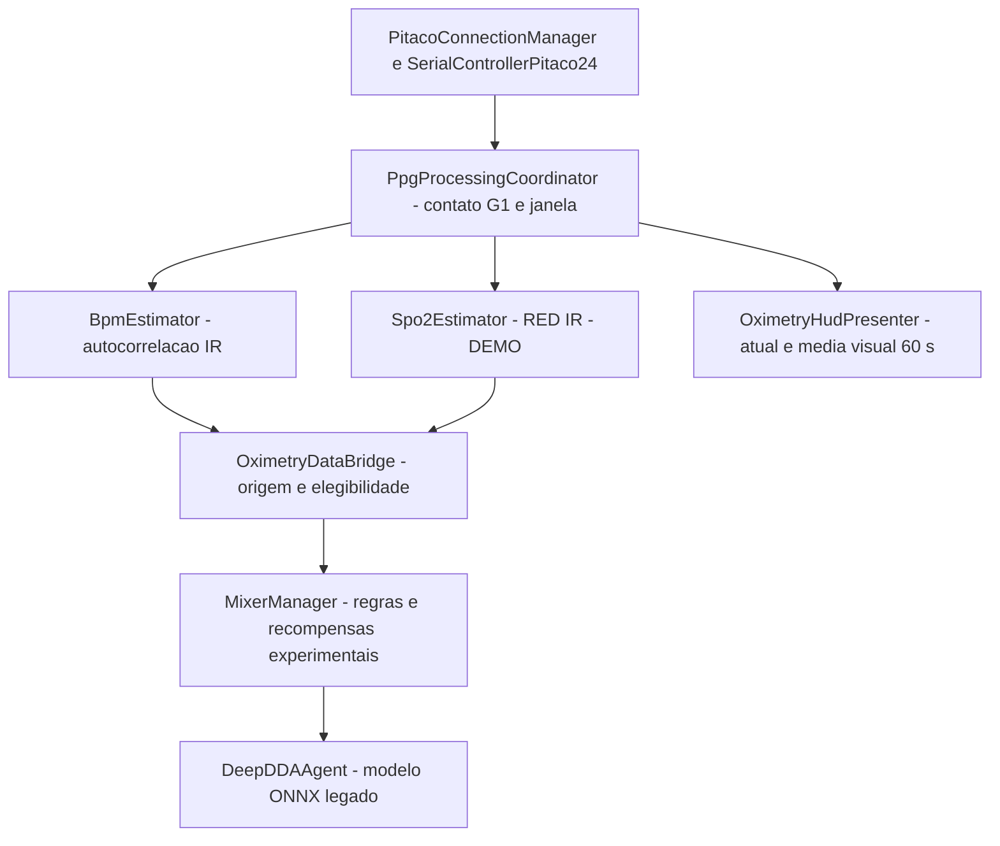
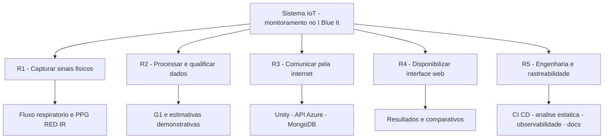

# Arquitetura IoT ponta a ponta

[Portal](../README.md) · [Índice](README.md) · [Integrações](INTEGRACOES.md)

**Natureza:** descrição da arquitetura integrada observada nos repositórios, com identificação explícita do que é experimental e do que ainda requer validação física. Atualizada com evidências de 23/11/2026.

## 1. Motivação e limites do sistema

O I Blue It já contempla um exergame respiratório, o PITACO, serviços de backend e um painel analítico. A extensão estudada adiciona aquisição PPG e processamento/visualização de medidas fisiológicas experimentais, preservando os dados respiratórios e o funcionamento legado. Por ser IoT, a integração não termina no firmware: dados seguem por um gateway/software local, internet, serviço remoto e aplicação web.

Na arquitetura implementada, **a Unity se conecta diretamente ao firmware PITACO por USB/serial, sem middleware Python**. A Unity usa a internet para comunicar-se com os serviços Azure; a interface web consulta a API remotamente. Isso configura um arranjo IoT com gateway de aplicação, não exige que o ESP32 acesse diretamente a internet. A adequação ao entendimento formal da banca deve ser demonstrada no diagrama.

## 2. C4 — contexto funcional (visão de alto nível)

A Unity é o ponto de integração local do hardware e da sessão do jogo. A API oferece escrita e leitura; o dashboard consome as rotas autenticadas/escopadas. O controle de acesso é um requisito a verificar de maneira específica, não uma propriedade implícita da plataforma Azure.

## 3. Camadas IoT — nível de contêineres

**Caminho principal:** firmware PITACO → **USB/serial direto** → Unity → HTTPS → Azure Functions → MongoDB Atlas. O frontend consulta a API por HTTPS. O **middleware Python/bridge USB/BLE** é um utilitário **independente e opcional** para GUI, monitoramento, coleta e diagnóstico em bancada. **Ele não encaminha dados obrigatoriamente para a Unity e não deve aparecer como intermediário da execução do jogo**. Usar apenas um consumidor por porta COM; a existência de BLE na ferramenta auxiliar não implica que a Unity se conecte via BLE.

## 4. Componentes e responsabilidades

| Contêiner | Entradas | Processamento / saída | Fonte técnica |
| --- | --- | --- | --- |
| MAX30105 e MPX5010DP | Contato óptico, sinal respiratório | RED/IR e valores respiratórios | [PITACO / arquitetura](https://github.com/PHV00/PITACO_ESP32/blob/main/docs/ARCHITECTURE.md) |
| ESP32-C3 / firmware 2.4 | Sensores | G1, contato, timestamps/seq e telemetria; controle USB/BLE | [PITACO / firmware](https://github.com/PHV00/PITACO_ESP32/tree/main/frimeware2.4) |
| Unity | Amostras e estado do jogo | Janela ~8 s, BPM IR, SpO₂ DEMO RED/IR, HUD, resultados e integração experimental Mixer | [Unity / consolidação](https://github.com/PHV00/iblueit-psychophysiological-flow-pitaco2.4-port/blob/main/docs/marcos/CONSOLIDACAO_PITACO24_UNITY_PPG_DEEPDDA_HUD_2026-11-22.md) |
| Azure Functions | Escrita/consulta HTTP | Contratos, idempotência, consultas, validações | [Backend / Marco 04](https://github.com/PHV00/iblueit-server-side/blob/main/docs/MARCO_04_ENCERRAMENTO.md) |
| MongoDB Atlas | Sessões e séries | Persistência de fluxo, BPM, SpO₂ DEMO e RED/IR | [Backend / API](https://github.com/PHV00/iblueit-server-side/blob/main/docs/PITACO3_READ_API.md) |
| Health InfoCharts | API | Gráficos/resultados/comparativos e filtros | [Frontend / Marco 04](https://github.com/PHV00/iblueit-health-Infocharts/blob/main/docs/MARCO_04_ENCERRAMENTO.md) |

## 5. Detalhamento do processamento Unity

- O **Gate 01** é decidido pelo firmware. Uma análise shadow do RAW na Unity não substitui a decisão do dispositivo.
- Dados inválidos, velhos ou sem contato não podem tornar-se medições utilizáveis por simples retenção visual.
- O histórico de 60 segundos do HUD é somente visual e não é a janela de 8 segundos dos estimadores.
- A SpO₂ DEMO tem bloqueio de elegibilidade em release comum e opt-in restrito ao desenvolvimento.
- A integração com DeepDDA é experimental **por regras/recompensas**. Não foi demonstrada a incorporação de PPG como novas entradas do modelo ONNX.

Fonte: [consolidação técnica Unity, 22/11/2026](https://github.com/PHV00/iblueit-psychophysiological-flow-pitaco2.4-port/blob/main/docs/marcos/CONSOLIDACAO_PITACO24_UNITY_PPG_DEEPDDA_HUD_2026-11-22.md).

## 6. Hierarquia de requisitos IoT

A representação abaixo organiza os requisitos da extensão em níveis e **não é um diagrama SysML normativo**; o diagrama de arquitetura em camadas acima cumpre a opção de arquitetura permitida no Playbook.

Os requisitos de engenharia são tratados individualmente em [CONFORMIDADE_IOT.md](CONFORMIDADE_IOT.md). Este diagrama organiza o escopo; não prova que todas as exigências já estejam atendidas.

## 7. Variantes e identificadores

| Nome encontrado | O que identifica, conforme a fonte | Não presumir |
| --- | --- | --- |
| PITACO 2.4 | Firmware ESP32-C3 canônico com MPX5010DP e MAX30105 | Que equivale ao sketch Uno ou ao binário físico usado em todos os logs |
| MAX30102 / Arduino Uno | Estudo de portabilidade no repositório de RFC | Que a integração ESP32-C3/Unity em bancada utiliza necessariamente esse sensor |
| PITACO 3.0 | Denominação nos contratos e telas de persistência/consulta | Que implica um firmware 3.0 publicamente versionado |
| I Blue It 5.0 | Base de jogo/Unity e ecossistema legado | Que toda ideia da RFC inicial foi implementada |
| I Blue It 6.0 | Nome da **proposta** registrado na RFC histórica | Que existe uma release clínica 6.0 validada |

A matriz montagem física → firmware gravado → branch Unity → payload → dashboard é uma **pendência de rastreabilidade**. Registrar hash/versão do firmware na inicialização e ambiente de cada teste é recomendado.

## 8. Decisões e riscos arquiteturais

1. Manter cada componente em seu repositório: reduz acoplamento de releases e conserva pipelines existentes.
2. Centralizar somente contratos, limites e visão sistêmica: evita múltiplas fontes divergentes.
3. A Unity consome diretamente USB/serial do firmware; Python e BLE são recursos auxiliares independentes.
4. Usar HTTPS/API para a nuvem, sem exigir conexão Wi-Fi direta do firmware.
5. Preservar as séries RAW para rastreabilidade; decimação no frontend afeta o desenho, não a base de dados documentada.
6. Não extrapolar a validade do SQI G1 para uma afirmação de qualidade fisiológica.
7. Não utilizar estimativas DEMO como gatilhos clínicos de alerta/pausa sem validação e autorização apropriadas.
8. Tratar autenticação, autorização por paciente, privacidade e observabilidade como requisitos auditáveis, não pressupostos.

[Seguir para a comunicação e os contratos →](INTEGRACOES.md)
